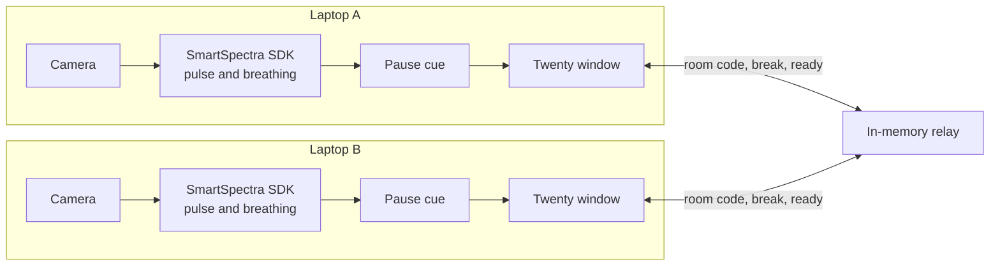

# Twenty

A shared pause when a conversation runs hot.

Each person runs Twenty on their own laptop, in the same room or on a video call, and joins a short room code. After a calm minute, if anyone's pulse stays well above their own baseline or near 100 beats per minute for about 20 seconds, both screens say **Someone needs a break**. They do not say who. A 20-minute guide follows. Each person taps **I'm ready**. A **Timeout** button is always there.

This is a wellness cue, not a medical device. It does not diagnose, treat, or score anyone.

## For judges

Get a free key at [physiology.presagetech.com](https://physiology.presagetech.com), open the app, and paste it in the Presage API key box. Then click **Save key on this computer**. **Solo demo** keeps your camera live and says the other person is simulated. With no key, the same screens run on practice signals and say so.

## On your Mac

The short path is the unsigned app `Twenty-1.0.0-arm64-mac.zip` (Apple chip). Steps are in `OPEN-ON-MAC.txt`: Control-click the app, choose Open, allow the camera, and paste the Presage key into the box in the app. Do not paste the key into Terminal, chat, or a screenshot. That zip was built on Linux and has not been launched on a Mac.

If you are running from this project instead:

1. Install Node.js 20 or newer from [nodejs.org](https://nodejs.org) (the macOS installer, Apple chip).
2. Open Terminal. Paste these lines. They do not include a key.

```bash
npm install
npm start
```

3. In the window, read the consent page, continue, then paste the key into **Presage API key** and click **Save key on this computer**. If a key is already saved, click **Use a different key**.

If the camera does not start, the window shows a **Details** line with the error name. The same line is printed in Terminal as `[twenty] camera start failed`. It does not include the API key. `npm start` uses Electron’s own app info, so macOS may still print “Add NSCameraUseContinuityCameraDeviceType to your Info.plist”. That warning is not the camera failure. A packaged build sets the key.

`npm install` downloads the SmartSpectra native runtime for every supported platform. That is a few hundred megabytes. Only the build for your Mac is loaded.

The window keeps context isolation on and Node out of the page. Sandbox is off because a sandboxed preload cannot load `@smartspectra/node-sdk/preload`. On an Apple M4 that setting logged `module not found` and the live camera never started.

## On Windows

SmartSpectra 3.5.0 ships a native 64-bit Windows runtime (`@smartspectra/node-sdk-win32-x64`, including `smartspectra_capi.dll`). The same two commands work in Command Prompt or PowerShell. Steps are in `OPEN-ON-WINDOWS.txt`.

```bat
npm install
npm start
```

Paste the key in the Presage API key box. Do not paste it into the terminal. A key saved in the app is stored at `%APPDATA%\Twenty\twenty.config.json`. Windows asks for camera permission the first time a live session starts. With no key, the app still opens in practice mode and says the numbers are not a measurement.

`npm run dist:win` builds an NSIS installer and a zip for Windows x64.

Built for the [Presage SmartSpectra SDK Challenge](https://dev.to/challenges/presage-2026-11-04). The desktop app follows Presage's [electron-quickstart](https://github.com/Presage-Security/SmartSpectra/tree/main/nodejs/samples/electron-quickstart): Electron, `@smartspectra/node-sdk`, `bindSmartSpectraIpc`, and the renderer SDK.

## Setup

Node.js 20 or newer (22 or 24 is a good choice). A webcam. Verified live on an Apple Silicon Mac. The installed SDK 3.5.0 also includes Windows x64 and Linux x64/arm64 runtimes.

```bash
npm install && npm start
```

`npm install` downloads the SmartSpectra native runtime for every supported platform. That is a few hundred megabytes, and only the build for your machine is loaded.

Then copy the example env file and add a key from [physiology.presagetech.com](https://physiology.presagetech.com/auth/register):

```bash
cp .env.example .env
```

```
SMARTSPECTRA_API_KEY=your-key-here
```

You can put the same values in `twenty.config.json` instead (`apiKey`, `relayUrl`). That file is gitignored. The shell environment wins over the file.

Without a key, the app still opens. **Solo demo** and **Start a practice room** use scripted signals and leave the camera off. They are labeled as practice. They are not a measurement.

If Electron exits immediately inside Cursor or VS Code, the terminal has `ELECTRON_RUN_AS_NODE` set. `npm start` clears it before launch.

## Two people

Twenty starts a relay on `127.0.0.1:47221` for rooms on that one computer. Another laptop cannot join it.

On a computer both people can reach:

```bash
npm run relay
```

That listens on `0.0.0.0` and `$PORT` (default `47221`). In both `.env` files:

```
TWENTY_RELAY_URL=ws://192.168.1.20:47221
```

Use the relay machine's LAN address. The relay keeps rooms in memory and drops them when they empty. It logs no room codes and no message bodies.

`render.yaml` is an optional Blueprint for that relay only. This project does not deploy it. Deploying it would make room codes and break/ready flags reachable at a public URL. Do that only if you mean to.

## Solo demo

**Solo demo** puts a simulated partner in the room. The partner is a generated pulse trace, not a recording of a person, and the screen says so the whole time.

- With an API key, your camera is live and your pulse stays on this computer.
- Without a key, your side is practice signals and the camera stays off.
- **Demo partner stays calm** leaves the cue to you (or to Timeout).
- Otherwise the partner's trace rises and holds, and the break can come from that trace. The screen still does not say who.
- **Mark demo partner ready** is only on the demo, so you can finish the ready step without waiting out a simulated person.

## What you do in the app

1. Read the consent screen. The camera is still off.
2. **I understand — keep going**, then **Start a room** or **Join** with the four-character code. That is the whole path.
3. Sit for about a minute of confident readings. Talking is fine. If the SDK says the framing or light is off, the minute waits.
4. Talk. **Timeout** is always available.
5. On a break, both screens use the same background (`#e6d2c3`). Follow the breath guide. Tap **I'm ready**. The room opens again only after the timer and both ready taps.
6. **Stop camera** turns the camera off. The indicator in the header is the camera state. **Leave room** drops the session.

A practice page can shorten the baseline and the 20-second cue for a UI walkthrough. Open the preview with `?baseline=8&sustain=4`. The real app ignores that. The 20-minute pause is enforced by the relay, not by the page.

```bash
npm run preview
```

That serves the same screens with practice signals at `http://127.0.0.1:43123` and does not load the native SDK.

## Mac package

On the Apple Silicon Mac:

```bash
npm run dist:mac
```

`electron-builder` writes a dmg under `release/`. The native libraries are copied out of the asar (they cannot be loaded from inside it) and `main.js` points `SMARTSPECTRA_CAPI_PATH` at them. Hardened runtime entitlements allow the camera and the SDK's bundled libraries. Sign and notarize with your own Apple identity before you distribute; the dylibs are ad-hoc signed by Presage's package.

## Tests

```bash
npm test
```

The flooding detector, the room protocol, the relay, the breathing guide, and the SDK error copy are covered. Tests do not need a key, a camera, or the native SDK.

## Architecture



The pause cue runs on each machine. Pulse and breathing never enter the relay. Solo demo runs the second participant in-process, through the same messages.

### Pause cue

SmartSpectra's pulse is a 12-second average, valid from 40 to 110 BPM, and the model card does not list talking as a failure (breathing does). Twenty uses pulse for the cue.

- About 60 seconds of confident, in-frame samples set a baseline. The baseline is the median.
- A minute whose median is already near 100 is discarded and started over. It is not a calm reference.
- After that, the cue fires when a confident pulse stays at or above the baseline plus 15 BPM, or at or above 96 BPM, for 20 seconds.
- Confidence is the SDK's 0–100 scale. Twenty acts at 60 or higher, and only when `stable` is true. Early zeros, while the 12-second window fills, do not count.
- Framing and lighting codes pause the clock. Chest-not-visible does not, because that code is about breathing. A pause longer than about 5 seconds drops a half-built 20-second stretch. A pause longer than about 15 seconds restarts the calm minute.
- After a cue, it clears only after confident readings sit a few BPM under both lines for 10 seconds. The room itself stays in the break until the relay says so.
- Readings outside 40–110 are ignored.

### Breathing guide

During the pause, a confident breathing rate (30-second average, 5–40 breaths per minute, confidence at least 60, chest in frame) sets a guide a little slower than that rate, clamped between 6 and 12 breaths per minute. Otherwise the guide is six breaths a minute: about four seconds in, six out. Stop the camera and the guide uses the default.

### SDK choices

- Metrics requested: breathing bundle and cardio bundle (`PULSE_RATE`, and the rest of `cardioMetrics`). Unavailable breathing metrics are not requested.
- `enableTelemetry: false` on every session.
- `requestInsight` is never called. No runtime AI service. See Consent and Data Handling.
- `checkDeviceReadiness` is not called, so Twenty does not trigger a readiness report.
- The app owns the `MediaStream`, passes it to `useMediaStream`, and asks for continuous exposure, white balance, and focus before start and before the tracks stop. The renderer SDK locks those to manual once processing is running and does not restore them ([issue 19](https://github.com/Presage-Security/SmartSpectra/issues/19)). On Linux that lock can outlive the process. On a Mac it may reset when the camera is released; Twenty still puts the controls back.
- If Presage answers with the known usage-verification failure (`kNetworkError`, often "Status code: 0", [issue 18](https://github.com/Presage-Security/SmartSpectra/issues/18)), the screen says nothing was measured and offers a retry. It does not loop by itself.
- If the key cannot load cardio ("Failed to load device keys" / `kMetricNotAuthorized`), Twenty tries once with breathing only and says the automatic cue needs pulse. Timeout and the guide still work.
- A sustained low frame rate is reported and not auto-restarted, matching the SDK guidance. Low light is a common cause, because auto-exposure lengthens the frame time.

## Consent and Data Handling

This is what the code does. The consent screen says the same facts in shorter sentences. `SUBMISSION.md` repeats this section so it can be pasted into the DEV post.

Twenty was written with help from Cursor, an AI coding agent. Cursor is not part of the running app. The app does not send the camera, pulse, breathing, room code, or API key to Cursor.

The running app talks to two places. It does not call any other AI or cloud model. There is no analytics package.

### Presage SmartSpectra

The dependency is `@smartspectra/node-sdk` 3.5.0. After the consent screen, if a key is present and practice mode is off, `src/live-session.js` opens the camera with `getUserMedia` and passes that stream to `useMediaStream`. Pulse and breathing are read back from the SDK `metrics` event on this computer. Twenty uses pulse for the pause cue and, during the quiet pause only, breathing to time the guide.

The SDK is constructed with `enableTelemetry: false` and `enableAccumulatedOutput: false`. The app never calls `requestInsight` (Presage’s feature that sends a question and measurements to an AI service) and never calls `checkDeviceReadiness`.

What Twenty’s code sends to Presage is the API key, because the SDK constructor requires it and Presage’s documentation says the library contacts Presage to check that key. Presage’s documentation says the measurement itself stays on the device, and that the key check is not an upload of video or measured values. A network connection is required for the check. Twenty adds no other Presage request.

Presage’s telemetry documentation says telemetry is on by default and can send session summaries and device-readiness reports. Those reports can include free text, file paths, and device details. They do not include raw frames or measured vitals. Authenticated requests can be tied to an account. Twenty sets telemetry off. See [SDK Telemetry & Privacy](https://smartspectra.presagetech.com/docs/telemetry-and-privacy).

Practice mode does not construct the SDK. That is the path when there is no key, or when `TWENTY_MOCK=1` is set. The camera stays off and the numbers are scripted in `src/mock-session.js`. The solo partner in `src/sim-peer.js` and `src/traces.js` is generated numbers, not a recording of a person. Those numbers stay on this computer. Only the same break and ready yes/no messages can leave.

### Room relay

`relay/server.js` is a WebSocket relay included in this project. It is not an AI service. By default the Electron app starts it on `127.0.0.1:47221`. Another computer is involved only if you set `TWENTY_RELAY_URL`. This project does not deploy a public relay.

The relay accepts only three messages (`src/protocol.js`):

- `join`: room code and a random connection id
- `break`: a boolean
- `ready`: a boolean

Anything else, including fields named like pulse, breathing, video, name, or who, is rejected. The message sent back to each window is the room code, whether a break is on, whether you are ready, whether the other person is ready, how many people are connected, and when the pause ends. The connection id is not included in that message. The health check returns `{ "ok": true }` and does not list rooms.

### What is stored, where, and for how long

- Camera frames, pulse, breathing, confidence, and the calm-minute baseline are kept in memory. Twenty does not write them to a file. They are dropped when you leave the room or quit.
- An API key you type into the app is written to `twenty.config.json` inside the app’s private settings folder, mode `0600` where the system allows it. On a Mac that folder is `~/Library/Application Support/Twenty/`. On Windows it is `%APPDATA%\Twenty\`. It stays there until you click **Remove saved key**. **Use a different key** opens the box again. The app does not print the key. The window is context-isolated with Node disabled in the page. Sandbox is off only so the SmartSpectra preload can load.
- A key you put in `.env` or in a project `twenty.config.json` stays in that file until you delete it. Both files are gitignored. The shell environment overrides the files. None of these copies are sent to the relay.
- The relay keeps the room in memory and deletes it when the last person disconnects. It has no database.
- There is no account and no session log.

### How to opt out

- Close the window on the consent screen. The camera is not opened.
- **Stop camera** releases the camera. The header shows **Camera off**.
- **Leave room** or quit drops the in-memory session.
- Do not set `TWENTY_RELAY_URL` if the room code should not leave this computer.
- **Remove saved key**, and delete `.env` if you created one. With no key, the app stays in practice mode and does not start the SDK.
- Telemetry is hard-coded off. There is no control that turns it on, and there is no in-app AI feature to disable.

### What this is not

Not a medical device. Not a diagnosis. The twenty minutes and the “near 100” figure are a wellness pause, used only on readings the SDK marks confident and inside 40–110 beats per minute. Either person can call a timeout with no reading, stop the camera, or leave.

## Project layout

| Path | Role |
| --- | --- |
| `main.js` | Window, camera permission, key loading, local relay |
| `preload.js` | SmartSpectra bridge plus config IPC |
| `renderer.js` | Screens |
| `src/flooding.js` | Pause cue |
| `src/protocol.js` | Room messages and hub |
| `src/live-session.js` | Real SDK adapter |
| `src/mock-session.js` | Practice signals |
| `src/sim-peer.js` | Solo demo partner |
| `relay/server.js` | WebSocket relay |
| `test/` | Unit tests |
| `SUBMISSION.md` | Draft DEV post |
| `DEMO-SCRIPT.md` | 2–3 minute recording script |
